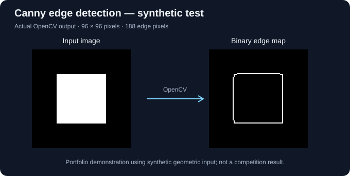

# Computer Vision Portfolio

**Azat Oral — Mechatronics Engineering | İzmir Kâtip Çelebi University**

A portfolio of computer vision, visual data preparation and experimental machine learning projects developed during my engineering studies.

## Featured Project — TEKNOFEST 2026

**Saturn Rocket Team · MİMAS**

I was individually responsible for the computer vision development work within our student engineering team for the 2026 competition. My work covered the preparation of visual data, manual image annotation, Python software development and experiments with YOLO-family models.

### Individual Contributions

- Visual data collection, annotation and dataset organization
- Python-based image and video processing
- Object detection model development and experimentation
- Software development and experimental evaluation
- Technical documentation and multidisciplinary teamwork

**Tools and technologies:** Python · OpenCV · YOLO · CVAT · Linux · Raspberry Pi

### Project Materials

The repository contains original competition materials uploaded by the author, including Python source files, interface files, model files and an annotation archive. These materials document work undertaken during the competition.

The presence of model files does not establish whether they are pretrained or custom-trained checkpoints. The original model performance and the complete competition software have not been independently validated for this portfolio. No unverified accuracy, mAP or deployment-performance figures are reported.

## Independent Computer Vision Examples

| Example | Description |
| --- | --- |
| [Canny Edge Detection](examples/image_processing/edge_detection.py) | Grayscale conversion, Gaussian smoothing and edge extraction on local images. |
| [Offline Video Frame Extraction](examples/video_processing/extract_frames.py) | Sampling local MP4 files and exporting JPEG frames. |
| [Software Tests](tests/test_examples.py) | Functional checks using synthetic images and videos. |



*Illustrative standalone image-processing demonstration, not a competition model result.*

## Run the Independent Examples

```bash
python -m pip install -r requirements.txt
python examples/image_processing/edge_detection.py path/to/image.jpg
python examples/video_processing/extract_frames.py ./videos ./frames
python -m unittest discover -s tests -v
```

### Verification

| Test | Result |
| --- | --- |
| Canny edge detection on a synthetic square | Passed |
| Offline frame extraction from a synthetic MP4 | Passed |

Both tests passed on 26 November 2026 with Python 3.13.5, OpenCV 4.13.0 and NumPy 2.3.5. These tests cover only the standalone examples, not the original competition models, GUI or integrated software.

## References

- Original work: my TEKNOFEST 2026 computer vision project materials.
- [OpenCV documentation](https://docs.opencv.org/)
- [Ultralytics documentation](https://docs.ultralytics.com/)
- [CVAT documentation](https://docs.cvat.ai/)
- [NumPy documentation](https://numpy.org/doc/)
