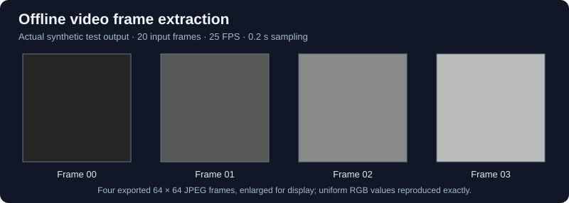

# Computer Vision Portfolio

**Azat Oral | Mechatronics Engineering | İzmir Kâtip Çelebi University**

Computer vision, dataset engineering and experimental machine learning projects, with an emphasis on practical Python development and reproducible results.

## Featured Project · TEKNOFEST 2026

**Saturn Rocket Team — MİMAS**  
**Role:** Computer Vision Developer

I independently carried out the computer vision work within the team, from collecting and manually annotating images to developing Python software and experimenting with YOLO-family models.

### Engineering Contributions

| Area | My contribution |
| --- | --- |
| Dataset engineering | Image annotation, organization and preparation of visual data |
| Model development | Experiments with YOLO-family object detection models |
| Computer vision | Image and video processing with Python and OpenCV |
| Software development | Python application development, interface work and experimental testing |

**Technology stack:** Python · OpenCV · YOLO · CVAT · Linux · Raspberry Pi

### Original Project Materials

The repository preserves the author's competition source files, model files, interface files and annotation archive. The available model filenames refer to YOLOv8n, YOLO11n and YOLO26n. The `rocket_son.zip` archive is associated with the author's most frequently used model experiments; it is not itself a verified trained-weight checkpoint.

Custom checkpoint provenance, comparative model accuracy and integrated system performance have not been independently verified. No model is ranked as the best without supporting evaluation records.

## Independent Computer Vision Demonstrations

### 01 · Canny Edge Detection


A standalone OpenCV example that converts an input image to grayscale, applies Gaussian smoothing and extracts a binary edge map.

**Verified result:** 188 nonzero edge pixels from a 96 × 96 synthetic input.

[View Python source](examples/image_processing/edge_detection.py)

### 02 · Offline Video Frame Extraction



An independent utility adapted from my original project archive. It samples local MP4 videos and saves the extracted frames as sequential JPEG files.

**Verified result:** four readable 64 × 64 JPEG frames from a 20-frame, 25 FPS synthetic video at a 0.2-second sampling interval.

[View Python source](examples/video_processing/extract_frames.py)

## Software Verification

| Independent test | Result |
| --- | --- |
| Canny edge detection | PASS — 188 edge pixels |
| Offline video frame extraction | PASS — 4 exported JPEG frames |

Both source files were matched to their GitHub blob hashes and tested on 26 November 2026 using Python 3.13.5, OpenCV 4.13.0 and NumPy 2.3.5.

The visual examples represent synthetic software tests, not competition photographs or YOLO accuracy benchmarks.

### Run the Independent Examples

```bash
python -m pip install -r requirements.txt
python examples/image_processing/edge_detection.py path/to/image.jpg
python examples/video_processing/extract_frames.py ./videos ./frames
```

The [standalone test suite](tests/test_examples.py) uses synthetic media rather than the original competition datasets.

## References & Attribution

- **Original project:** Azat Oral — TEKNOFEST 2026 computer vision development, Saturn Rocket Team / MİMAS.
- **Visual demonstrations:** generated from independent OpenCV test outputs for this portfolio.
- [OpenCV documentation](https://docs.opencv.org/)
- [Ultralytics documentation](https://docs.ultralytics.com/)
- [CVAT documentation](https://docs.cvat.ai/)
- [NumPy documentation](https://numpy.org/doc/)
